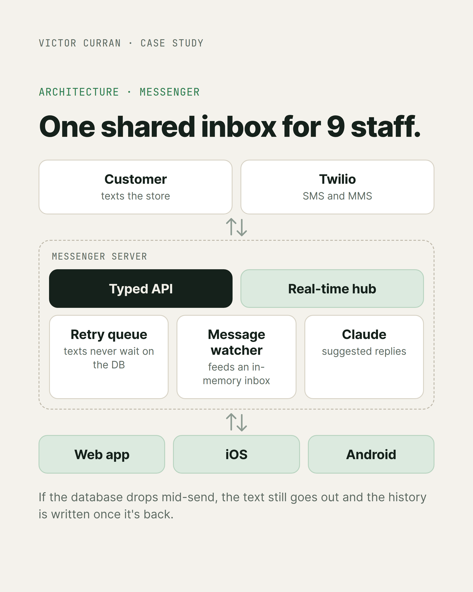
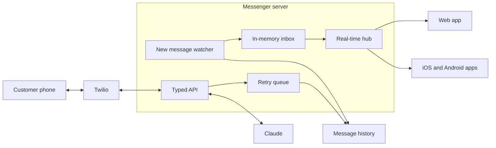
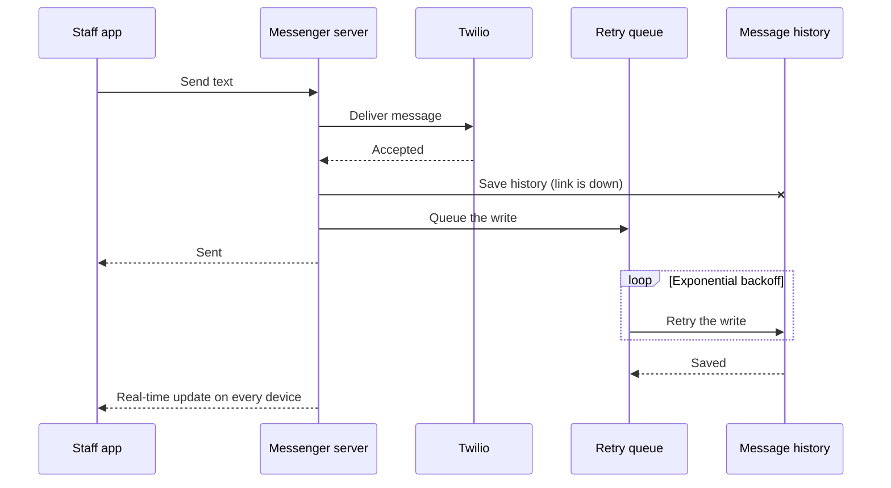

# Team Messaging Platform: A Shared Texting Inbox for a Retail Team

*Built for [Settlemyre Nursery](https://settlemyrenursery.com), a family-owned garden center and landscaping business.*

**Role:** Took over a non-functioning legacy web app and rebuilt it; sole engineer since (design, build, deployment, support)

**Server:** Bun, Hono, tRPC, Zod, WebSockets, SQL Server (message history), SQLite (local retry queue), Docker

**Web:** Next.js, React, Tailwind CSS, Radix UI

**Mobile:** React Native with Expo (iOS and Android), Expo Router, TanStack Query

**Integrations:** Twilio (SMS and MMS), Claude API (suggested replies), Expo push and Web Push

**Status:** In production

> This is a case study, not the source code. The production repo is private and belongs to Settlemyre Nursery.

---

  

<!-- SCREENSHOT: The inbox on iPhone, Android, and the web app. Load demo data first so no real customer names or phone numbers show.

  
  
  

-->

## Overview

A lot of the nursery's customer conversation happens over text. Messenger gives the whole team (9 active staff) one shared inbox for those conversations on their phones and on desktop, plus internal team chat, so nobody is texting customers from a personal phone and nothing falls through the cracks.

## The problem

- **The message history lives on a server Messenger can't always reach.** Every text is saved in our own message tables, which sit on the same database server as the point of sale system. Messenger reaches that server over a network link that can drop.
- **A team inbox needs to answer one question fast:** which customers are waiting on us?
- **Notifications have to be right.** Missing one means a customer waits. Getting three for the same text means people start ignoring them.

## Rebuilding a broken app

When I took Messenger over, it was a web app that barely worked. I rebuilt it into a working web app plus native iOS and Android apps: a typed monorepo with real-time updates and a proper account system with roles, so admins and staff get different access.

The rebuild had one hard rule: never break the version people were already using. The old and new sign-in flows ran side by side until every client had updated, and I upgraded how passwords are stored without forcing anyone to reset theirs. Each user's password was quietly moved to the new scheme the next time they signed in.

## Key decisions

### 1. One server, three clients, one set of types

The web app, the iOS and Android apps, and the server live in one monorepo and share a typed API layer and a shared package of typed real-time events. A change to a message shape breaks the build everywhere at once instead of quietly breaking one client in production.

### 2. A text never waits on the database

If the database link drops mid-send, the customer's text still goes out through Twilio. The history write goes into a durable local queue instead, and a background worker replays it with exponential backoff once the database is reachable again. Staff never see a failed send because of something they can't fix.

### 3. An inbox that opens instantly

The original approach polled the database and re-ran a heavy query to build the conversation list. I replaced it with a lightweight watcher that only looks for new messages, publishes them as typed events, and keeps an in-memory conversation list updated incrementally. A periodic full reload reconciles any drift. Opening the app no longer waits on the database at all.

### 4. "Needs reply" is computed, not stored

A thread needs a reply when the customer's latest message is newer than our latest reply. That's calculated, so it fixes itself the moment someone answers. Staff can also flag a thread by hand ("come back to this one") or dismiss it ("no reply needed"), and both clear themselves at the right moment: a flag drops when we reply, and a dismissal drops when the customer texts again. The rules live in one pure function with no database dependency, so they're fully unit tested.

<!-- SCREENSHOT: Inbox showing the Needs reply and Awaiting reply badges, with demo data.

  

-->

## Bugs worth telling

**Duplicate notifications.** Staff were getting the same notification more than once. Every re-login created a new device record that registered the same push token, and the sender pushed once per record. Now one physical phone owns one token, and the sender de-duplicates tokens as a second safety net.

**The missing photo.** A customer sent two photos and only the first one showed up. The app was refreshing on an early "message arrived" signal, which came in before the photos had finished saving. Now each message is tracked by its Twilio ID: when the fully stored version lands, clients refresh again to pick up the media, without sending the staff a second notification.

**Spam.** Spam texts were pinging the whole team. Blocking is now team-wide and silent: blocked threads leave the inbox and stop notifying anyone, but stay in a Spam view so a mistaken block can be undone.

## AI suggested replies

Staff get suggested replies generated by Claude. The original version used OpenAI with function calls to look up FAQ answers and company info, but that data never changed. I moved it into a cached system prompt, which turned two round trips into one streamed request and lets repeat suggestions hit the prompt cache, so they're faster and cheaper.

<!-- SCREENSHOT: A conversation with AI suggested replies showing, with demo data.

  

-->

## Other things worth mentioning

- **Share a product in chat:** search the catalog and drop a clean product link into the conversation. I switched the search to an exact title match after noticing the storefront's relevance ranking could miss a product whose name literally contained every word typed.
- **Push on every device:** native push on iOS and Android, and Web Push for desktop browsers, from the same sender
- **Per-user pins** for the conversations someone is actively working
- **Sessions that rotate** on every refresh and stay signed in with regular use

## Architecture

### Zoom in: sending a text while the database is down

The customer gets the text immediately. The history catches up on its own once the database is reachable, and every staff device updates when it does.

## Results

- One shared inbox used by 9 active staff on phone and desktop
- Texts still send when the database link is down, with history backfilled automatically
- Server logic covered by unit tests across the inbox cache, reply state, retry queue, real-time hub, and auth

<!-- Optional: conversations per week, response time before and after. -->

## What I learned

Design around your least reliable dependency. Once I assumed the database could disappear at any moment, the retry queue, the in-memory inbox, and the watcher all followed naturally. The other lesson: state you compute can't go stale, so compute it whenever you can.

---

**Victor Curran** · [GitHub](https://github.com/sn-Victor) · [LinkedIn](https://linkedin.com/in/victor-curran)
